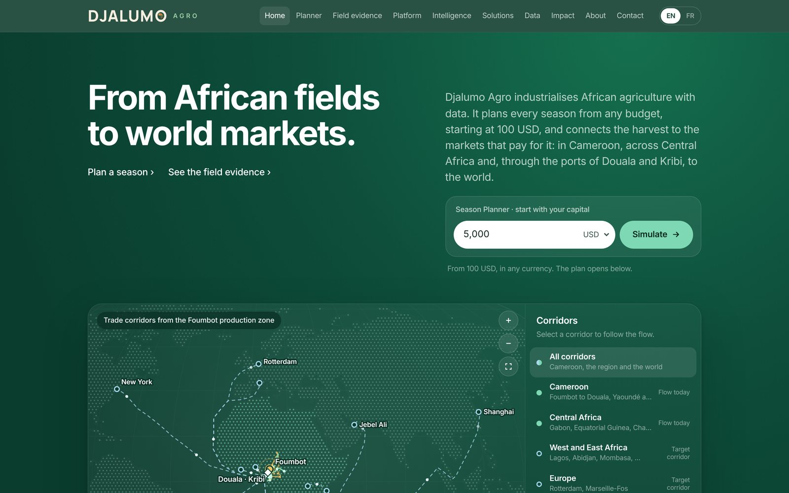
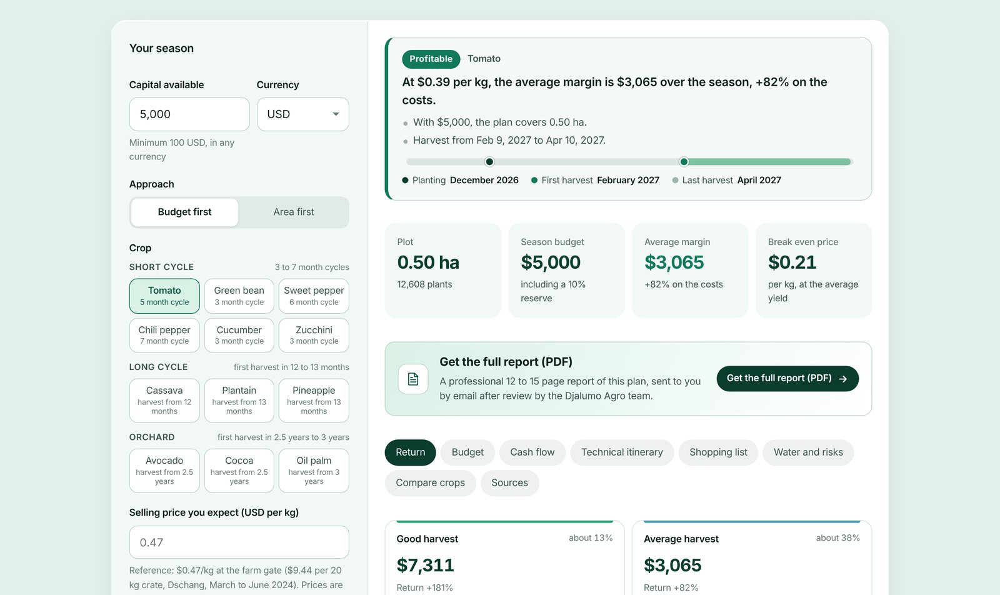
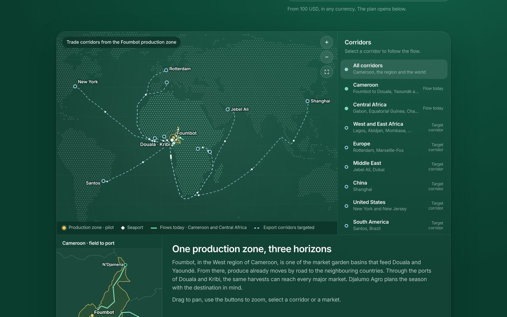
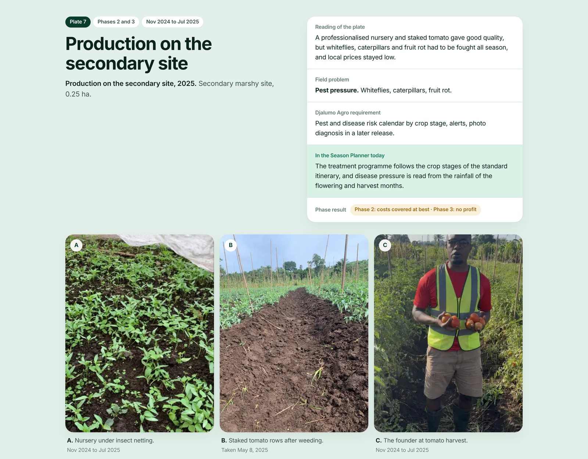
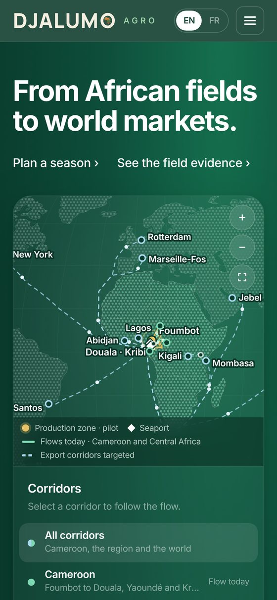

  <picture>
    <source media="(prefers-color-scheme: dark)" srcset="brand/DJALUMO-AGRO_couleur-fond-sombre.svg">
    
  </picture>

<h3 align="center">L'intelligence décisionnelle agricole pour l'Afrique</h3>

  <a href="https://djalumo-agro.vercel.app"><b>Site en ligne</b></a> ·
  <a href="https://djalumo-agro.vercel.app/planner">Planificateur de saison</a> ·
  <a href="https://djalumo-agro.vercel.app/field">Preuves terrain</a> ·
  <a href="docs/TECHNICAL.fr.md">Documentation technique</a> ·
  <a href="README.md">English version</a>

## Présentation

Djalumo Agro transforme un budget agricole, de 100 USD à plus d'un million, en un plan de saison avec ses coûts, son calendrier et ses résultats attendus. La plateforme relie ensuite la récolte aux marchés qui la paient : au Cameroun, en Afrique centrale et, par les ports de Douala et de Kribi, dans le reste du monde.

Le projet est né d'une vraie saison de production. De septembre 2024 à octobre 2025, son fondateur a conduit un pilote maraîcher à Foumbot, dans la région de l'Ouest du Cameroun. Chaque difficulté rencontrée sur le terrain, du coût caché de l'eau au stress climatique et aux récoltes vendues sans emballage, est devenue une fonction de la plateforme.

La plateforme couvre aujourd'hui 12 cultures, s'appuie sur 187 sources référencées, documente le pilote par 73 photographies de terrain et représente 17 corridors commerciaux, en anglais et en français.

## Le problème

Avant de planter, un producteur ou un investisseur au Cameroun doit répondre à trois questions : quoi cultiver, quelle surface son argent couvre réellement, et quand démarrer. Ces réponses viennent le plus souvent de l'habitude et des conseils entre voisins. Les besoins en eau, la chaleur à la floraison, la pression des maladies et le prix à la récolte se découvrent pendant la saison, lorsqu'ils sont déjà devenus des coûts.

## Ce que fait la plateforme

**Planificateur de saison.** L'utilisateur saisit un capital dans la devise de son choix, puis choisit une culture, une situation en eau et une date de démarrage. Le planificateur indique la surface que couvre ce capital, un itinéraire technique daté, un budget détaillé, une liste d'achats, le bilan hydrique, les risques de la période choisie, la trésorerie et quatre issues possibles, de la bonne récolte à l'échec, chacune avec sa rentabilité et le prix nécessaire pour couvrir les coûts. Il couvre les cultures à cycle court (tomate, haricot vert, poivron, piment, concombre et courgette), les cultures à cycle long (manioc, plantain et ananas) et les vergers (avocatier, cacaoyer et palmier à huile). Les six cultures à cycle court peuvent aussi être planifiées sous serre, et la tomate sous maison filet : une nouvelle structure est dimensionnée en modules de 240 m² avec son coût et le climat sous l'abri, tandis qu'une structure déjà construite n'est pas rachetée et seuls son entretien et les réparations choisies sont comptés. La préparation du terrain se fait à la main ou avec des machines louées, et le planificateur suggère les machines lorsque la surface demanderait trop d'ouvriers le même jour.

**Corridors commerciaux mondiaux.** Une carte interactive suit la production depuis la zone de Foumbot jusqu'aux ports de Douala et de Kribi, puis vers l'Afrique centrale, l'Afrique de l'Ouest et l'Afrique de l'Est, l'Europe, le Moyen-Orient, la Chine, les États-Unis et l'Amérique du Sud. Les flux existants et les corridors d'exportation visés sont présentés et légendés séparément.

**Preuves terrain.** Le pilote est documenté par 73 photographies réunies en huit planches, de la plantation familiale en 2021 à la relance du site principal du pilote en 2025. Chaque planche donne ses légendes, ses dates et l'enseignement tiré de la saison.

**Rapport PDF.** Un visiteur peut demander un rapport de 12 à 15 pages sur son plan. Ce rapport est produit sur le serveur par le même moteur et n'est envoyé qu'après relecture et validation par l'équipe Djalumo Agro.

## Méthode

Le projet suit le cadre PACE (Planifier, Analyser, Construire, Exécuter) enseigné dans le certificat professionnel Google Advanced Data Analytics.

| Étape | Travail réalisé |
| --- | --- |
| **Planifier** | Définir les décisions qu'un producteur ou un investisseur doit prendre avant une saison, à partir des problèmes rencontrés pendant le pilote : marché, sol, climat, eau et prix. Identifier les utilisateurs : petits producteurs dès 100 USD, coopératives, investisseurs agricoles et acheteurs. |
| **Analyser** | Réunir et documenter 187 sources : fiches techniques et budgets du ministère de l'Agriculture du Cameroun (MINADER), méthodes de la FAO, guides d'instituts de recherche, enquêtes régionales sur le prix des intrants et relevés datés des prix de marché de 2017 à 2026. Construire un profil climatique mensuel de Foumbot et un indice saisonnier des prix. |
| **Construire** | Bâtir un moteur de décision transparent : besoins en eau des cultures selon le bulletin FAO d'irrigation et de drainage n° 56 (évapotranspiration de référence de Hargreaves, coefficients culturaux et pluie fiable), réponse du rendement au déficit hydrique selon le bulletin FAO n° 33, modèle de coûts à l'hectare, dimensionnement de la parcelle avec une réserve de 10 %, quatre issues pondérées par leur probabilité, prix et rendement nécessaires pour couvrir les coûts, trésorerie et délai de retour pour les cultures à cycle long, et lecture des risques pour chacun des douze mois de démarrage possibles. |
| **Exécuter** | Livrer un site bilingue de 14 pages avec le planificateur, la carte, les preuves terrain, des formulaires sécurisés, une base PostgreSQL et des rapports PDF soumis à validation, le tout couvert par des tests automatisés. Chaque chiffre affiché renvoie à sa source, et toute valeur sans source est présentée comme une hypothèse. |

## Compétences mises en œuvre

* Collecte, documentation et nettoyage de données publiques, institutionnelles et de terrain
* Modélisation analytique : bilan hydrique, réponse du rendement, analyse de scénarios, seuils de rentabilité et trésorerie
* Visualisation de données : cartes et graphiques interactifs construits avec les projections géographiques D3
* Python pour la préparation des données : génération de la base de connaissances et traitement des photographies
* JavaScript et Node.js, SQL et PostgreSQL, tests automatisés
* Conception de produit et communication bilingue envers les producteurs, les partenaires et les investisseurs

## Transparence des chiffres

Le planificateur ne présente jamais des données simulées comme réelles. Il affiche ses sources, distingue les valeurs calculées et les hypothèses, et laisse un prix vide lorsqu'aucune référence fiable n'existe, en demandant au producteur un prix local plutôt que de l'estimer. Le moteur applique aujourd'hui des règles agronomiques et financières documentées à des données sourcées. Les modèles prédictifs viendront lorsque le pilote de 2027 aura produit ses propres données de terrain.

## Pensé pour les conditions du terrain

Beaucoup de producteurs se connectent avec un smartphone simple et un réseau lent. Le site ne charge donc aucun framework ni aucune police web, et s'adapte aux petits écrans comme aux connexions faibles.

**Application Android.** La même plateforme existe sous forme d'application Android qui fonctionne sans connexion : le Planificateur de saison, la carte des corridors et les preuves de terrain sont enregistrés sur le téléphone, et seuls les formulaires et les demandes de rapport passent par le réseau. Une version de test est produite automatiquement à chaque modification et publiée dans les [versions](https://github.com/franckdjandja/djalumo-agro/releases) de ce dépôt.

## Feuille de route

| Période | Étape |
| --- | --- |
| Fin 2026 | Nom de domaine propre, application web installable, application Android et test fermé sur Google Play |
| Début 2027 | Outils de collecte de données terrain, enquête de référence auprès des producteurs de Foumbot et relevé hebdomadaire des prix de marché |
| Mars 2027 | Relance du pilote de Foumbot, avec des données collectées saison après saison |
| Ensuite | Carnets d'analyse en Python, premiers modèles prédictifs des rendements et des prix, nouvelles cultures et nouvelles régions |

## Technologies

Le site est généré à partir de modules JavaScript simples et servi par des fonctions serverless Node.js sur Vercel. Il utilise Zod pour la validation, PostgreSQL (Neon) pour le stockage, les projections géographiques D3 et TopoJSON pour les cartes, PDFKit pour les rapports et Python pour la préparation des données. L'architecture, les sources de données, la configuration et le déploiement sont décrits dans la [documentation technique](docs/TECHNICAL.fr.md).

## Auteur

**Franck Junior Djandja Tomwa**, fondateur et porteur du projet Djalumo Agro. Ingénieur en télécommunications et analyste de données, chargé des opérations internationales. Titulaire du certificat professionnel Google Advanced Data Analytics (2026) et du certificat professionnel Google Data Analytics (2025).

GitHub : [franckdjandja](https://github.com/franckdjandja)

## Licence

Copyright © 2026 Franck Junior Djandja Tomwa. Tous droits réservés. Ce dépôt est public afin que le travail puisse être vu et évalué ; il n'est pas open source. Les conditions figurent dans la [licence](LICENSE.md).
